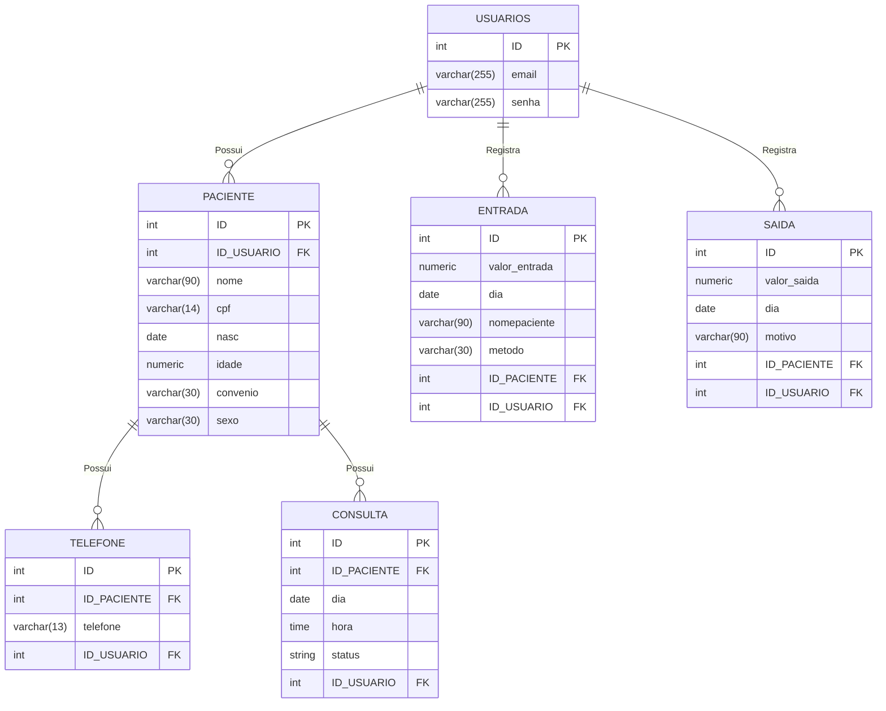

# Clínica Arco-Íris 🌈 - Sistema de Gestão Psicológica

A Clínica Arco-Íris é uma aplicação web desenvolvida para gerenciar de forma prática, organizada e segura as operações essenciais de uma clínica de psicologia. O projeto foi estruturado com foco em controle de pacientes, agendamento de consultas e acompanhamento de fluxo financeiro de maneira simples e prática.

Sistema: Clínica Arco-Íris
Versão: 1.10
Data: Outubro de 2026

---
# 1 Introdução
## 1.1 Propósito
Este documento especifica os requisitos funcionais, não-funcionais e regras de negócio para o Sistema da Clínica Arco - Íris, seguindo as diretrizes de especificação do padrão ISO/IEC/IEEE 29148:2018.

## 1.2 Escopo
O sistema permite que o administrador crie uma conta e faça login. Após isso, o administrador pode cadastrar seus pacientes, atualizar suas informações, apagar o paciente, marcar e gerenciar consultas, visualizar os pacientes cadastrados e acompanhar a movimentação financeira com as entradas e saídas de dinheiro.


# 2 Descrição

## 2.1 Funções Principais
O sistema permite que o administrador:

- Crie uma conta
- Faça login
- Cadastre novos pacientes
- Atualize os dados de seus pacientes
- Apague os dados de seus pacientes
- Visualize todos os nomes de seus pacientes de uma só vez
- Visualize todos os dados de apenas um paciente em específico
- Marque sessões de terapia
- Remarque essas sessões
- Cancele as sessões
- Atualize os status das sessões (cancelada, realizada)
- Visualize as sessões em seu calendário
- Faça logout 

## 2.3 Classes de usuários

| **TIPO DE USER** | **DESCRIÇÃO** | **PERMISSÕES** |
| --- | --- | --- |
| Administrador | Pessoa que possui conta criada logada em uma sessão | Pode gerenciar as informações de pacientes, sessões de terapias e o movimento financeiro |


## Tecnologias Utilizadas

### O projeto foi construído focando em uma arquitetura limpa e padrão procedural seguro:
 - **Linguagem Backend:** PHP (PDO para acesso ao banco de dados com prepared statements)
 - **Banco de Dados:** PostgreSQL (Gerenciado via pgAdmin 4 ou Moba) 
 - **Frontend:** HTML5, CSS3
 - **Ferramentas de Desenvolvimento:** VS Code, Git e GitHub.


# 3 Requisitos e Regras de Negócio
## Engenharia de Requisitos (Padrão ISO 29148) 
A arquitetura do software foi guiada estritamente pela documentação de requisitos para garantir consistência lógica e regras bem definidas:

## 3.1 Definições e acrônimos
| **TERMO** | **DEFINIÇÕES** |
| --- | --- |
| CRUD | Sigla representativa para Create, Read, Update and Delete |
| DER | Diagrama Entidade-Relacionamento |
| RF | Requisito Funcional |
| RNF | Requisito Não Funcional |
| RN | Regra de Negócio |

## 3.2 Requisitos Funcionais (RF)
- **RF-001 (Abertura de Conta):** Permite a abertura de um novo paciente solicitando obrigatoriamente o nome completo do mesmo.
- **RF-002 (Modificação de Perfil):** Permite ao usuário root modificar qualquer informação dos pacientes.
- **RF-003 (Apagando Perfis):** Permite ao usuário root apagar perfis de antigos clientes.
- **RF-004 (Agendando Consultas):** Permite a adição de uma nova consulta com nome do paciente, dia e horário.
- **RF-005 (Mudando Status de Consultas):** Permite alterar o status da consulta de agendada para realizada.
- **RF-006 (Cancelando Consultas):** Permite mudar o status da consulta para cancelada, removendo-a do calendário.
- **RF-007 (Consulta de Extrato):** Exibe em tela as últimas movimentações financeiras e o saldo atual.
- **RF-008 (Menu Interativo):** Disponibiliza menu de navegação no header para transição entre as páginas.

## 3.3 Requisitos Não-Funcionais (RNF)
- **RNF-001 (Acompanhamento Financeiro):** O sistema deve possuir um gráfico para acompanhar a gestão financeira.
- **RNF-002 (Visualização em Calendário):** O sistema deve possuir um calendário para exibir as consultas agendadas.

## 3.4 Regras de Negócio (RN)
- **RN-001 (Validação da Consulta):** Toda consulta deve ser cobrada no valor de R$ 200,00.
- **RN-004 (Restrição de Idade Mínima):** O atendimento é exclusivo para pacientes com idade igual ou superior a 03 anos.

- Você pode acessar a **Documentação completa:** 👉 [Acesse aqui para vissualizar](https://github.com/dudamarrtiins/clinica_arco_iris/tree/main/documentacao)

## 4 Estrutura do projeto

```bash
\ clinica_arco_iris
|   index.php  - página inicial, pergunta se tem conta
|
|   painel.php - página principal
|
|   README.md  - este arquivo README
|   
+---app  - pasta com todas as páginas "principais"
|
|       agenda.php  - possui o calendario
|
|       agendamento.php - administra os agendamentos
|
|       apaga.php - apaga paciente
|
|       atualizar.php - atualiza as infor dos pacientes
|
|       cadastraPaciente.php - cadastra os pacientes
|
|       consultar.php - pesquisa um paciente e seus dados
|
|       entrada.php - faz a entrada de um valor em dinheiro
|
|       extrato.php - mostra o extrato de entradas e saídas
| 
|       gestao.php - painel principal
|
|       prontuario.php - mostra o nome de todos os pacientes
|
|       remarcar.php - remarca um atendimento
|
|       saida.php - faz a saída de um valor em dinheiro
|
|       status.php - muda o status da consulta 
|       
+---database - pasta com os arquivos de conexão
|
|       arcoires.sql - dump do banco
|
|       config.php - configuração de conexão|
|
|       configLocal.php
|
|       connect.php
|
|       connet2.php
|       
|       
+---documentacao
|
|   |   documentacao.md  - documentação completa
|   |   
|   \---banco_de_dados 
|           dicionario_dados_arcoires.xlsx - dump do banco
|
|           mermaid.md  - DER 
|           
+---includes
|       footer.php - rodapé do site
| 
|       functions.php - funções

|       header.php - Nav principal

|       headerProntuario.php - Nav do prontuário 
|       
+---login - Pasta com os arquivos de login
|
|       cadastrar.php - cadastra o usuário

|       login.php - faz o login

|       logout.php - página para sair do site

|       verifica_user - verifica se o user existe 
|       
\---sql
        backup_clinica.sql - dump do banco
```

## 5 Banco de dados

# 5.1 DER


# 5.2 Dicionário de Dados
- Você pode acessar o **Dicionário de dados:** 👉 [Acesse aqui para baixar o arquivo](https://github.com/dudamarrtiins/clinica_arco_iris/blob/main/database/banco_de_dados/dicionario_dados_arcoires.xlsx)


# 6 Product Backlog

| **Identificação** | **Item** | **Descrição** | **Prioridade** |
|---|---|---|---|
| 01 | Cadastro de Usuário | O sistema deve permitir que os usuários criem uma conta a partir de um e-mail e uma senha | Alta |
| 02 | Login | O sistema deve permitir que o usuário logue na aplicação com a conta criada no cadastro | Alta |
| 03 | Cadastro de Pacientes | O sistema deve permitir que o administrador cadastre pacientes, não permitindo campos vazios | Alta |
| 04 | Atualização de Pacientes | O sistema deve permitir que as informações do paciente sejam editáveis | Alta |
| 05 | Apagar Pacientes | O sistema deve permitir apagar pacientes do banco de dados | Alta |
| 06 | Visualizar Pacientes | O sistema deve permitir a visualização dos dados dos pacientes | Alta |
| 07 | Agendar consultas | O sistema deve permitir o agendamento de sessões de terapia | Alta |
| 09 | Atualização de status | O sistema deve permitir a atualização de status de "agendada" para "realizada" | Média |
| 10 | Cancelamento de consultas | O sistema deve permitir que as sessões/consultas sejam canceladas | Alta |
| 11 | Remarcar consultas | O sistema deve permitir que a consulta seja remarcada com um novo dia e horário | Alta |
| 12 | Entrada de Pagamento | O sistema deve permitir que as entradas de dinheiro sejam registradas no banco de dados | Alta |
| 13 | Vinculação de pagamento com paciente | O sistema deve permitir que a entrada de dinheiro seja vinculada com o nome do paciente que pagou | Alta |
| 14 | Saída de dinheiro | O sistema deve permitir que as saídas de dinheiro sejam registradas e salvas no banco de dados | Alta |
| 15 | Extrato | O sistema deve permitir que as movimentações financeiras registradas sejam visualizadas em um extrato organizado em ordem cronológica | Média |
| 16 | Visualização do financeiro | O sistema deve mostrar a movimentação financeira por meio de um gráfico | Média |
| 17 | Visualização de consultas | O sistema deve permitir que as sessões agendadas apareçam em um calendário com seus respectivos dias, horários e nomes de pacientes | Alta |
| 19 | Visualização por cor no gráfico | O sistema deve permitir que o gráfico apresente coloração verde para entradas e vermelha para saídas | Baixa |
| 20 | Visualização por cor no calendário | O sistema deve permitir que as sessões apresentem coloração diferente para cada status | Baixa |

# 7 Design
- Você pode acessar a **prototipagem:** 👉 [Acessar Projeto no Canva](https://canva.link/pztms13j0ivh8h6)


# 8 COMO EXECUTAR A APLICAÇÃO: 
### Requisitos

- PostgreSQL instalado e em execução.
- PHP instalado, com as extensões `PDO` e `pdo_pgsql` habilitadas.
- Os arquivos deste repositório.
- Navegador Web

  ---

### 1. Obter os arquivos do projeto
Clone este repositório:

 abra o terminal, git bash ou o prompt de comando e execulte:

- acesse a pasta desejada para guardar o projeto:
```bash
cd pasta
```
- após acessar execulte:
```bash
git clone https://github.com/dudamarrtiins/clinica_arco_iris.git
```

- acesse a pasta:
```bash
cd clinica_arco_iris
```


### 2. Criar o usuário e o banco de dados
Dentro desse repositorio, esta um arquivo do **dump do banco de dados**, com este arquivo você recriara toda a estrutura do banco de dados necessario. **Siga as instruções:**

Conecte-se ao Postgres:

- abra o terminal, ou o prompt de comando e execulte (**em windows**):
- ```bash
  psql -U postgres
  ```

  - abra o terminal e execulte (**em Linux**):
- ```bash
  sudo  -u postgres psql
  ```

Acesse o Postgres e crie um novo banco de dados e um novo usuario

- crie um novo usuario:
```sql
CREATE USER root WITH PASSWORD 'arcoires';
```

- crie um novo database e atribua a propriedade dele ao usuario criado:
```sql
CREATE DATABASE arcoires OWNER root;
```

- confira se tudo ocorreu como deveria:
```sql
\l
```

- saia do login do postgres, com o comando:
```sql
\q
```

### 3. Restaurar o database
  - Certifiquesse que esta na raiz do projeto (pasta principal) e execulte o comando a baixo para restaurar o banco. O arquivo com a estrutura do banco fica em `database/banco_de_dados/arcoiris.sql`. Execute-o no banco `arcoires` usando o terminal::

- se o terminal estiver aberto dentro da pasta database/banco_de_dados execulte:
  ```sql
  psql -U root -d arcoires -f arcoiris.sql
  ```
- Se não, execulte com o caminho:
  ```sql
  psql -U root -d arcoires -f "database/banco_de_dados/arcoiris.sql"
  ```
Quando solicitado, informe a senha do usuário `root`. Esse comando cria as tabelas necessárias para a aplicação


### 4. Configurar a conexão da aplicação

No arquivo `database/config.php`, configure os dados do banco local. O arquivo deve ter este formato:

```php
<?php
define('DB_HOST', 'localhost'); // adicione o IP da sua maquina no localhost
define('DB_PORT', '5432');  // porta padrão utilizada, NÃO DEXE SER ALTERADA
define('DB_NAME', 'arcoires');  // nome do banco de dados criado
define('DB_USER', 'root');   // nome do usuário criado
define('DB_PASS', 'arcoires');  // senha do banco de dados
?>
```
após a alteração devida SALVE o arquivo.

### 5. Conferir o driver do PostgreSQL no PHP

O PHP precisa ter a extensão `pdo_pgsql` habilitada. Se a aplicação mostrar um erro de driver ou de conexão, confira o arquivo `php.ini` usado pelo PHP e habilite a linha abaixo, removendo o ponto e vírgula inicial, se houver:

```bash
extension=pdo_pgsql
```

Salve o arquivo e reinicie o servidor PHP depois da alteração.

### 6. Iniciar a aplicação

Abra um terminal na pasta principal do projeto e execute:

```bash
php -S localhost:8000
```

### 7. Acessar o sistema

Abra o navegador e acesse:
```bash
http://localhost:8000
```

### Problemas comuns:

- **Não foi possível conectar ao banco:** confira se o serviço PostgreSQL está em execução, se o banco se chama `arcoires` e se usuário, senha e porta estão corretos em `database/config.php`.

- **`could not find driver`:** habilite `pdo_pgsql` no `php.ini` usado pela aplicação e reinicie o servidor PHP.

- **`psql` não é reconhecido:** use o caminho completo do `psql.exe`.

---
# 9 Controle de Versões
| Versão | Data | Descrição das Alterações | Autor(es) |
| :---: | :---: | --- | :---: |
| **1.0** | 10/10/2026 | Criação do repositório, elaboração inicial da documentação, criação do Diagrama Entidade-Relacionamento (DER) e modelagem de dados. | Maria E |
| **1.1** | 11/10/2026 | Continuação da modelagem de dados e evolução da documentação técnica. | Maria E |
| **1.2** | 12/10/2026 | Implementação do controle de sessões e funções de relacionamento para isolamento de contas de usuário. Criação das páginas do CRUD (prontuário, cadastro e visualização individual de pacientes). | Maria E |
| **1.3** | 12/10/2026 | Ajuste e correção dos relacionamentos no banco de dados SQL (chaves primárias e estrangeiras). | Maria E |
| **1.4** | 14/10/2026 | Inclusão do dump do banco de dados e aplicação da função `LOWER` no SQL. Atualização do DER, criação do Dicionário de Dados e inclusão de campos na tabela de entradas e saídas (nome do paciente e motivo). Atualização do README. | Maria E |
| **1.5** | 15/10/2026 | Padronização e reestruturação dos caminhos relativos e absolutos de navegação no painel principal. | Maria E |
| **1.6** | 16/10/2026 | Correção dos links do README e ajustes finais nas rotas centrais da aplicação. | Maria E |
| **1.7** | 20/10/2026 | Atualização e revisão periódica do README. | Maria E |
| **1.8** | 21/10/2026 | Implementação de validações de idade mínima e limite de entradas. Correção na persistência do nome do paciente no extrato, ajuste na função de atualizar idade, correção do link do `git clone` e adição de comentários no código. | Maria E |
| **1.9** | 22/10/2026 | Finalização da documentação do código (comentários) e últimas revisões/modificações no README e na documentação técnica. | Maria E |

---
## 10. Conclusão

O desenvolvimento do sistema de gestão para a **Clínica Arco-Íris** alcançou com êxito todos os objetivos propostos para o ciclo do projeto. A aplicação web entregue oferece uma solução eficiente, segura e intuitiva para o gerenciamento de pacientes, agendamento de consultas e acompanhamento do fluxo financeiro, atendendo diretamente às necessidades operacionais de uma clínica de psicologia.

Com a implementação de uma arquitetura limpa em PHP e PostgreSQL, o sistema garante a integridade dos dados e a persistência correta das informações através do uso de prepared statements e chaves relacionais bem estruturadas. Além disso, a aderência às diretrizes da norma ISO/IEC/IEEE 29148:2018 permitiu alinhar com precisão os Requisitos Funcionais, Não-Funcionais e Regras de Negócio — como a restrição de idade mínima e a precificação padrão das consultas.

---
## Autoria 
Desenvolvido por Maria Eduarda Martins Pereira

Projeto desenvolvido para o curso técnico em Desenvolvimento de Sistemas — SENAI.

© 2026 Clínica Arco - Íris. Todos os direitos reservados.
