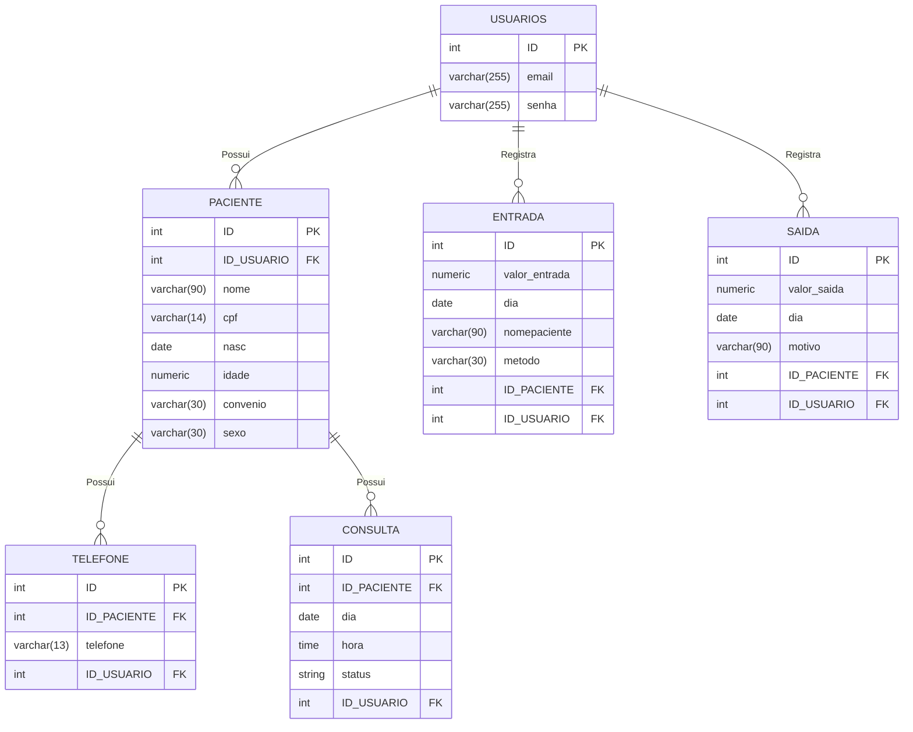

# Clínica Arco-Íris 🌈 - Sistema de Gestão Psicológica

 A Clínica Arco-Íris é uma aplicação web desenvolvida para gerenciar de forma prática, organizada e segura as operações essenciais de uma clínica de psicologia. O projeto foi estruturado com foco em controle de pacientes, agendamento de consultas e acompanhamento de fluxo financeiro de maneira simples e pratica.

 ```bash
    "Este projeto foi desenvolvido para fins academicos."
 ```

---
# 1 Introdução
## 1.1 Propósito

## 1.2 Escopo

## 1.3 Contexto

A aplicação permite que piscicologos - ou secretarios - administrem todas as informações de seus pacientes em um só lugar. Os dias de terapia, dados de pagamento, dados sensiveis dos pacientes ficam armazenados no mesmo sistema, facilitando na hora de acesso. O administrador, pode criar uma conta, fazer login, cadastrar um paciente - administrar os dados desse paciente, ou seja, atualizar ou apagar - Administrar sessôes de terapia - ou seja, marcar, remarcar e cancelar - E gerenciar as finançãs da clínica.

## 1.4

# 2 Descrição

## 2.1 Funções Principais
O sistema permite que o administrador:

- crie uma conta
- Faça login
- Cadastre novos pacientes
- Atualize os dados de seus pacientes
- Apague os dados de sues pacientes
- Vissualize todos os nomes de seus pacientes de um só vez
- Vissualize todos os dados de apenas um paciente em esspecífico
- Marque sessões de terapia
- Remarque essas sessões
- Cancele as sessões
- Atualize os status das sessões (cancelada, realizada)
- Vissualize as sessões em sue calendario
- Faça logout 

## 2.3 Classes de usuários
```
|**TIPO DE USER**|**DESCRIÇÃO**|**PERMISSÕES**                        |
|Administrador   | Pessoa que possui conta criada logada em uma sessão| Pode gerenciar as informações de pacientes, sessões de terapias e o movimento financeiro|
```

## Tecnologias Utilizadas

 ### O projeto foi construído focando em uma arquitetura limpa e padrão procedural seguro:
  - **Linguagem Backend:** PHP (PDO para acesso ao banco de dados com prepared statements)
  -  **Banco de Dados:** PostgreSQL (Gerenciado via pgAdmin 4 ou Moba) 
  - **Frontend:** HTML5, CSS3
  - **Ferramentas de Desenvolvimento:** VS Code, Git e GitHub.


# 3 Requisitos e Regras de Negócio
 ## Engenharia de Requisitos (Padrão ISO 29148) 
A arquitetura do software foi guiada estritamente pela documentação de requisitos para garantir consistência lógica e regras bem definidas:

## 3.1 Definições e acrônimos
|**TERMO**|**DEFINIÇÕES**|
|CRUD|Sigla representativa para Create, Read, Update and Delete|
|DER| Diagrama Entidade-Relacionamento|
|RF|Requisito Funcional|
|RNF|Requisito Não Funcional|
|RN|Regra de Negócio|

## 3.2 Requisistos Funcionais (RF)
- (RF-001): Registro obrigatório com validações para nome completo, CPF, telefone, data de nascimento, endereço e convênio.

- Edição e Gestão de Perfil (RF-002): Permissão para atualizar e alterar dados de pacientes cadastrados a qualquer momento.

- Remoção de Clientes (RF-003): Exclusão definitiva de perfis de pacientes.

- Extrato Financeiro Dinâmico (RF-004): Apresentação detalhada das movimentações de entradas e saídas.

- Navegação e Interface Interativa (RF-005): Painel acessível para transição rápida entre a agenda de atendimentos, cadastro e fluxo financeiro.

  ## 3.3 Requisistos não funcionais (RNF)

  ## 3.4 Regras de Negócio (RN)
  - RN-001 (Valor da Consulta): Definição do valor padrão de R$ 200,00 para cada consulta agendada.
  
-  RN-002 (Liberação de Atendimento): Sessões subsequentes à primeira só são liberadas caso a consulta anterior já tenha a confirmação de pagamento.


## 4 Estrutura do projeto

```bash
\ clinica_arco_iris
|   index.php  - página inicial, pergunta se tem conta
|
|   painel.php - página principal
|
|   README.md  - este arquivo README
|   
+---app  - pasta com todas as páginas "principais"
|
|       agenda.php  - possui o calendario
|
|       agendamento.php - administra os agendamentos
|
|       apaga.php - apaga paciente
|
|       atualizar.php - atualiza as infor dos pacientes
|
|       cadastraPaciente.php - cadastra os pacientes
|
|       consultar.php - pesquisa um paciente e seus dados
|
|       entrada.php - faz a entrada de um valor em dinheiro
|
|       extrato.php - mostra o extrato de entradas e saídas
| 
|       gestao.php - painel principal
|
|       prontuario.php - mostra o nome de todos os pacientes
|
|       remarcar.php - remarca um atendimento
|
|       saida.php - faz a saída de um valor em dinheiro
|
|       status.php - muda o status da consulta 
|       
+---database - pasta com os arquivos de conexão
|
|       arcoires.sql - dump do banco
|
|       config.php - configuração de conexão|
|
|       configLocal.php
|
|       connect.php
|
|       connet2.php
|       
|       
+---documentacao
|
|   |   documentacao.md  - documentação completa
|   |   
|   \---banco_de_dados 
|           dicionario_dados_arcoires.xlsx - dump do banco
|
|           mermaid.md  - DER 
|           
+---includes
|       footer.php - rodapé do site
| 
|       functions.php - funções

|       header.php - Nav principal

|       headerProntuario.php - Nav do prontuário 
|       
+---login - Pasta com os arquivos de login
|
|       cadastrar.php - cadastra o usuário

|       login.php - faz o login

|       logout.php - página para sair do site

|       verifica_user - verifica se o user existe 
|       
\---sql
        backup_clinica.sql - dump do banco
```

## 5 Banco de dados

# 5.1 DER


# 5.2 Dicionário de Dados

# 6 Product Backlog

# 7 Design
- Você pode acessar a **prototipagem:** 👉 [Acessar Projeto no Canva](https://canva.link/pztms13j0ivh8h6)


- Você pode acessar a apresentação visual: 👉 [Ver Projeto no Canva]()


# 8 COMO EXECUTAR A APLICAÇÃO: 
### Requisitos

- PostgreSQL instalado e em execução.
- PHP instalado, com as extensões `PDO` e `pdo_pgsql` habilitadas.
- Os arquivos deste repositório.
- Navegador Web

  ---

### 1. Obter os arquivos do projeto
Clone este repositório:

 abra o terminal, git bash ou o prompt de comando e execulte:

```bash
git clone https://github.com/dudamarrtiins/clinica_arco_iris.git
```

- acesse a pasta desejada:
```bash
cd clinica_arco_iris
```


### 2. Criar o usuário e o banco de dados
Conecte-se ao Postgres:

- abra o terminal, git bash ou o prompt de comando e execulte:
- ```bash
  psql -U postgres
  ```

Acesse o Postgres e crie um novo banco de dados e um novo usuario

- crie um novo usuario:
```sql
CREATE USER root WITH PASSWORD 'arcoires';
```

- crie um novo database e atribua a propriedade dele ao usuario criado:
```sql
CREATE DATABASE arcoires OWNER root;
```

- confira se tudo ocorreu como deveria:
```sql
\l
```

- saia do login do postgres, com o comando:
  ```sql
  \q
  ```
### 3. Restaurar o database
  - Certifiquesse que esta na raiz do projeto (pasta principal) e execulte o comando a baixo para restaurar o banco.o arquivo com a estrutura do banco fica em `database/arcoires.sql`. Execute-o no banco `arcoires` usando o terminal::

  ```sql
  psql -U root -d arcoires -f arcoires.sql
  ```
Quando solicitado, informe a senha do usuário `root`. Esse comando cria as tabelas necessárias para a aplicação


### 4. Configurar a conexão da aplicação

No arquivo `database/config.php`, configure os dados do banco local. O arquivo deve ter este formato:

```php
<?php
define('DB_HOST', 'localhost'); // adicione o IP da sua maquina no localhost
define('DB_PORT', '5432');  // porta a ser utilizada
define('DB_NAME', 'arcoires');  // nome do database
define('DB_USER', 'root');   // nome usuario
define('DB_PASS', 'arcoires');  // senha
?>
```

### 5. Conferir o driver do PostgreSQL no PHP

O PHP precisa ter a extensão `pdo_pgsql` habilitada. Se a aplicação mostrar um erro de driver ou de conexão, confira o arquivo `php.ini` usado pelo PHP e habilite a linha abaixo, removendo o ponto e vírgula inicial, se houver:

```bash
extension=pdo_pgsql
```

Salve o arquivo e reinicie o servidor PHP depois da alteração.

### 6. Iniciar a aplicação

Abra um terminal na pasta principal do projeto e execute:

```bash
php -S localhost:8000
```

### 7. Acessar o sistema

Abra o navegador e acesse:
```bash
http://localhost:8000
```

### Problemas comuns:

- **Não foi possível conectar ao banco:** confira se o serviço PostgreSQL está em execução, se o banco se chama `arcoires` e se usuário, senha e porta estão corretos em `database/config.php`.

- **`could not find driver`:** habilite `pdo_pgsql` no `php.ini` usado pela aplicação e reinicie o servidor PHP.

- **`psql` não é reconhecido:** use o caminho completo do `psql.exe`.

